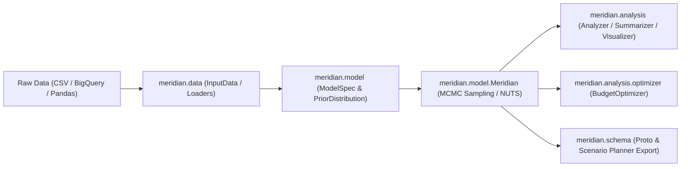

# Google Meridian MMM Architecture, Comparison & Technical Deep Dive

---

## 1. Meridian vs. Current Applications (Pros & Cons: Why We Need Meridian)

### 1.1 Context: What Meridian Solves
Marketing Mix Modeling (MMM) historically suffered from multiple flaws:
1. **Aggregated National-only Models**: Obscuring local nuances, losing degrees of freedom, and masking channel saturation at regional scales.
2. **Correlation ≠ Causation**: Inability to integrate causal ground-truth (incrementality experiments, geo-lift experiments, brand lift).
3. **Black-box Heuristics**: Ad-hoc decay (Adstock) and diminishing return (Hill) curve fitting without full posterior uncertainty estimation.
4. **Third-Party Cookie Deprecation & Privacy**: Attribution models (MTA) breaking down due to privacy restrictions (GDPR, ATT, Third-Party Cookie phase-outs).

Google Meridian addresses this by delivering an **open-source, Bayesian causal MMM engine** implemented with **TensorFlow Probability (TFP)** and **Xarray**, optimized for GPU hardware.

---

### 1.2 Comparison Matrix: Meridian vs. Existing MMM / In-House / MTA Approaches

| Capability / Dimension | Standard Legacy MMM / In-House Regressions (OLS, Ridge, Prophet) | Meta Robyn / LightweightMMM | Multi-Touch Attribution (MTA) | **Google Meridian** |
| :--- | :--- | :--- | :--- | :--- |
| **Statistical Paradigm** | Frequentist / OLS / Ridge / Splines | Ridge Regression (Robyn) / Bayesian HMC (LightweightMMM) | Rule-based (Last Click, Multi-Touch) / Shapley | **Full Bayesian Hierarchical MCMC (No-U-Turn Sampler - NUTS)** |
| **Geo-Level Modeling** | Poor (often pooled or simple fixed effects) | Limited geo-treatment | User-level cookies / IPs (failing) | **First-class Hierarchical Geo-Level Data Support** |
| **Experimental Calibration** | Manual prior tweaking or ad-hoc post-processing | Ad-hoc penalty function (Robyn) | Incompatible | **Native Bayesian Calibration with Geo-Lift / Experiment Priors** |
| **Reach & Frequency (RF)** | Spend / Impressions only | Not modeled directly | Impression counts without saturation curve by frequency | **Unique Reach & Frequency Modeling with optimal frequency curves** |
| **Uncertainty Quantification** | Point estimates or basic bootstrap | Pareto front multi-objective optimization (non-probabilistic) | None | **Full Posterior Credible Intervals for ROI, mROI, spend, and response** |
| **Hardware & Speed** | CPU-bound (Python/R) | CPU-bound (R) / JAX (LightweightMMM) | Cloud BigQuery / Spark | **GPU-accelerated Tensors (CUDA via TensorFlow Probability)** |
| **Enterprise Handoff** | Static PDFs / Excel sheets | Static HTML reports | Dynamic BI dashboards | **Protobuf Schema, Looker Studio Scenario Planner & MLflow autologging** |

---

### 1.3 Pros and Cons of Adopting Meridian

#### **PROS (Why You Need Meridian):**
- **Bayesian Causal Calibration**: Seamlessly incorporates results from randomized geo-experiments and incrementality tests as informative Bayesian priors.
- **Reach & Frequency Channel Decomposition**: Allows digital channels (YouTube, Meta, Display) to be split into reach curves and target frequency optimizations rather than naive gross impressions.
- **National vs. Geo Modeling**: Scales from national-level time series up to hundreds of Designated Market Areas (DMAs) or postal regions, providing statistical power.
- **Rigorous MCMC Diagnostics**: Provides Gelman-Rubin $\hat{R}$, effective sample size (ESS), MAPE, Weighted MAPE, and R-squared out of the box.
- **Scenario Planning & Budget Optimization**: Includes non-linear constrained optimization (SLSQP via SciPy / custom tensor backends) for fixed and flexible budget planning, plus spend grid generators for BI dashboards.
- **Production Integration**: Protobuf-based schema (`mmm_proto_generator.py`) and MLflow autologging built directly into the codebase.

#### **CONS & Trade-offs:**
- **Compute Intensity**: MCMC sampling with NUTS across 4 chains can take from 15 minutes to an hour on CPU. A T4/V100/A100 GPU is recommended.
- **Data Engineering Prerequisites**: Requires granular data engineering (aligning geos, times, media channels, non-media controls, organic spend, and experiment results).
- **Steeper Bayesian Learning Curve**: Interpreting prior/posterior distributions, knot intervals, and Gelman-Rubin convergence requires understanding probabilistic modeling.

---

## 2. How to Implement: Models, Classes, Code & Auto-Processing Architecture

### 2.1 Core Architectural Flow
The pipeline operates in 5 deterministic stages:



---

### 2.2 Key Classes and Their Roles

1. **Data Layer (`meridian.data`)**:
   - `InputData`: Core multi-dimensional container using Xarray. Validates dimensions across `geo`, `time`, `media_channel`, `rf_channel`, `organic_media_channel`, and `control_variable`.
   - `DataFrameDataLoader` / `CsvDataLoader`: Builders to ingest tabular datasets and map column names to MMM dimensions.
   - `TimeCoordinates`: Manages modeling windows, warm-up (adstock carryover) periods, and evaluation splits.

2. **Specification & Calibration Layer (`meridian.model.spec`)**:
   - `ModelSpec`: Defines the mathematical blueprint (e.g., `prior`, `knots`, `saturation_type`, `holdout_id`).
   - `PriorDistribution`: Configures Bayesian prior distributions (Lognormal, Half-Normal, Normal, Beta) for Adstock decay ($\alpha$), Hill half-saturation ($K$), Hill slope ($S$), and ROI.
   - `CalibrationSpec` & `ChannelCalibrationSpec`: Enforces geo-experiment results into channel priors.
   - `HoldoutSpec` (`GeoHoldoutSpec`, `RandomHoldoutSpec`): Sets up validation splits for out-of-sample testing.

3. **Execution & Inference Engine (`meridian.model.model`)**:
   - `Meridian`: Main model class. Orchestrates:
     - `sample_prior()`: Generates synthetic checks from prior distributions.
     - `fit()`: Executes MCMC sampling (No-U-Turn Sampler / NUTS) across multiple chains and draws.
     - `save_mmm()` / `load_mmm()`: Serializes and deserializes the fitted model state.

4. **Analytics & Budget Optimization (`meridian.analysis`)**:
   - `Analyzer`: Computes posterior distributions of KPI contributions, ROIs, marginal ROIs (mROI), response curves, and fit metrics (MAPE, weighted MAPE, $R^2$).
   - `Summarizer`: Generates structured executive summaries and HTML reports.
   - `Visualizer`: Produces diagnostic plots (`ModelDiagnostics`, `ModelFit`, `MediaEffects`, `ReachAndFrequency`).
   - `BudgetOptimizer`: Solves non-linear constrained budget allocation problems using:
     - `optimize()`: Finds optimal channel budgets under fixed or flexible constraints.
     - `create_optimization_grid()`: Pre-computes spend grids for interactive what-if dashboards.

---

### 2.3 Automated End-to-End Processing Script

```python
"""Automated Production Pipeline for Meridian MMM."""

import os
from meridian.analysis import analyzer, optimizer, summarizer, visualizer
from meridian.data import load
from meridian.model import model, prior_distribution, spec


def run_automated_mmm_pipeline(
    data_csv_path: str,
    output_dir: str,
    kpi_col: str = "revenue",
    n_chains: int = 4,
    n_adapt: int = 500,
    n_burnin: int = 500,
    n_keep: int = 1000,
):
  os.makedirs(output_dir, exist_ok=True)

  # 1. Automated Data Ingestion
  data_loader = load.CsvDataLoader(
      csv_path=data_csv_path,
      kpi_type="revenue",  # or 'non_revenue'
      geo_col="geo",
      time_col="date",
      kpi_col=kpi_col,
      population_col="population",
      media_cols=["search_impressions", "social_impressions"],
      media_spend_cols=["search_spend", "social_spend"],
      controls_cols=["competitor_sales", "promotions"],
  )
  input_data = data_loader.load()

  # 2. Automated Model Specification & Bayesian Priors
  model_spec = spec.ModelSpec(
      prior=prior_distribution.PriorDistribution(),
      knots=1,  # baseline time-varying knots
      saturation_type=spec.SaturationType.HILL,
  )

  # 3. Model Initialization & Sampling (NUTS / MCMC)
  mmm = model.Meridian(input_data=input_data, model_spec=model_spec)
  print("Fitting Meridian Bayesian MMM with MCMC NUTS...")
  mmm.fit(
      n_chains=n_chains,
      n_adapt=n_adapt,
      n_burnin=n_burnin,
      n_keep=n_keep,
      current_devices=None,  # Auto-selects GPU if available
  )

  # Save trained model artifact
  model_path = os.path.join(output_dir, "meridian_fitted_model.pkl")
  model.save_mmm(mmm, model_path)
  print(f"Model saved to {model_path}")

  # 4. Diagnostics & Analytics Engine
  ana = analyzer.Analyzer(mmm)
  health = mmm.health_summary()
  print("MCMC Health (Max R-hat):", health["rhat"].max())

  summary_tool = summarizer.Summarizer(mmm)
  summary_tool.output_model_results_summary(
      file_path=os.path.join(output_dir, "meridian_summary.html")
  )

  # 5. Budget Optimization Scenario
  opt = optimizer.BudgetOptimizer(mmm)
  scenario = opt.optimize(
      scenario_name="Optimal_Allocation_10pct_Budget_Increase",
      budget=input_data.aggregate_media_spend.sum().values * 1.10,
      pct_spend_bounds=(0.7, 1.3),  # channel spend bounded to +/-30%
  )

  print("Optimization complete. Optimal spend by channel:")
  print(scenario.optimal_spend)
  return mmm, scenario
```

---

## 3. Industry-Grade Application Overview: Structured Evaluation Guide

When evaluating whether to deploy Meridian into an enterprise analytics stack, use this structured framework:

### 3.1 Data Architecture & Integration
*   **Q: Does our data pipeline support geo-level temporal aggregation?**
    *   *Industry Standard*: Weekly or daily metrics across DMAs/regions with population weighting. Meridian performs best at geo-weekly granularity.
*   **Q: How does Meridian handle missing data and uneven reporting periods?**
    *   *Implementation*: Meridian validates rectangular matrices through `validator.py`. Missing geos/dates must be imputed or aligned prior to `InputData` construction.
*   **Q: Can we autolog hyperparameters, priors, and posterior traces?**
    *   *Industry Standard*: Meridian includes a native MLflow integration (`meridian.mlflow.autolog`) that records metrics, parameters, and model artifacts directly into enterprise model registries.

### 3.2 Model Convergence & Bayesian Rigor
*   **Q: How do we know the model has converged reliably?**
    *   *Standard Checks*: Gelman-Rubin diagnostic ($\hat{R} < 1.05$), effective sample size ($\text{ESS} > 400$ per chain), and lack of divergences in No-U-Turn Sampler.
*   **Q: What prevents overfitting or multicollinearity between channels?**
    *   *Implementation*: Hierarchical Bayesian pooling, informative priors on channel parameters, and Adstock/Hill parameter constraints reduce variance and prevent collinear spend spikes from overfitting.

### 3.3 Business Decisioning & Enterprise Handoff
*   **Q: Can non-technical stakeholders run what-if budget simulations?**
    *   *Solution*: The `meridian.schema` module produces protocol buffer files (`mmm_proto_generator.py`) consumed by the Looker Studio Scenario Planner dashboard.
*   **Q: Does the model support incrementality testing calibration?**
    *   *Solution*: Yes, using `CalibrationSpec`. Experiment-derived incrementality priors constrain channel ROIs to empirical ground truth.

---

## 4. Complete Functional Catalog of the Meridian Codebase

Below is an exhaustive classification of all modules, classes, and public functions within Google Meridian:

```
meridian/
├── data/              # Data ingestion, transformation, validation, and dimension indexing
├── model/             # Bayesian model math, MCMC sampling, equations, prior distributions
├── analysis/          # Posterior evaluation, ROI/mROI, budget optimization, visualization
├── common/            # Shared errors, currency formatting, and utilities
├── backend/           # Device configuration (GPU/CPU) and TFP/TensorFlow bindings
├── mlflow/            # MLflow experiment tracking and autologging integration
├── proto/             # Protocol buffer definitions for cross-platform model export
└── schema/            # Translators between Meridian model objects and Proto schemas
```

---

### Module 1: `meridian.data` (Data Layer)

| Component | Type | Description |
| :--- | :--- | :--- |
| `InputData` | Class | Main validated multi-dimensional dataset container (coordinates: geo, time, channel). |
| `InputDataLoader` | Class | Abstract base loader class for constructing `InputData`. |
| `CsvDataLoader` | Class | Ingests CSV files, maps column names, and instantiates `InputData`. |
| `DataFrameDataLoader`| Class | Ingests pandas DataFrames and maps dimensions. |
| `XrDatasetDataLoader` | Class | Ingests raw Xarray `Dataset` objects. |
| `TimeCoordinates` | Class | Manages modeling date boundaries, warm-up windows, and temporal indices. |
| `validator.py` | Utility | Validates data dimensions, non-negative spends, and alignment of coordinates. |

---

### Module 2: `meridian.model` (Bayesian Model & Inference)

| Component | Type | Description |
| :--- | :--- | :--- |
| `Meridian` | Class | Primary user-facing MMM class. Controls `fit()`, `sample_prior()`, posterior traces, and diagnostics. |
| `ModelSpec` | Class | Blueprint configuration for priors, knots, Adstock decay, Hill saturation, and holdout groups. |
| `PriorDistribution`| Class | Defines prior probability distributions for parameters ($\alpha$, $K$, $S$, baseline, controls). |
| `CalibrationSpec` | Class | Defines experimental calibration targets for one or more media channels. |
| `ChannelCalibrationSpec`| Class | Calibration parameters (confidence interval, lift estimate, test dates) for an individual channel. |
| `GeoHoldoutSpec` | Class | Geo-based out-of-sample holdout split specification. |
| `RandomHoldoutSpec` | Class | Random geo-temporal holdout specification for cross-validation. |
| `adstock_hill.py` | Math | Implements geometric Adstock decay and non-linear Hill saturation transformations. |
| `equations.py` | Math | Core Bayesian linear equations combining media, controls, trends, and seasonal knots. |
| `posterior_sampler.py`| Sampler | Executes TensorFlow Probability NUTS sampler across GPU/CPU workers. |
| `prior_sampler.py` | Sampler | Generates prior-predictive samples to evaluate model behavior before fitting. |
| `save_mmm()` | Function | Serializes fitted `Meridian` object to disk. |
| `load_mmm()` | Function | Restores a serialized `Meridian` model from disk. |

---

### Module 3: `meridian.analysis` (Diagnostics, ROI & Budget Optimizer)

| Component | Type | Description |
| :--- | :--- | :--- |
| `Analyzer` | Class | Primary analysis engine. Calculates: <br>• `incremental_outcome()`: Channel incremental conversions/revenue.<br>• `get_incremental_kpi()`: Point and interval estimates for KPI.<br>• `expected_outcome()`: Predicted vs. actual values.<br>• `roi()` / `mroi()`: Return on Investment and marginal ROI posterior draws.<br>• `response_curves()`: Diminishing returns response curves per channel. |
| `BudgetOptimizer` | Class | Solves constrained convex/non-linear budget allocations using SLSQP/tensors: <br>• `optimize()`: Reallocates budget to maximize target KPI.<br>• `create_optimization_grid()`: Generates pre-computed response grids for scenario planning.<br>• `create_optimization_tensors()`: Formulates tensor structures for fast vector evaluations. |
| `FixedBudgetScenario` | Class | Result container for optimizations with fixed spend. |
| `FlexibleBudgetScenario`| Class | Result container for optimizations targeting variable spend / target ROI. |
| `Summarizer` | Class | Formats analytical outputs into structured HTML and executive summaries (`output_model_results_summary()`). |
| `Visualizer` | Class | Generates publication-ready diagnostic charts: <br>• `ModelDiagnostics`: $\hat{R}$, ESS, convergence.<br>• `ModelFit`: Actual vs. predicted fit over time and geos.<br>• `MediaEffects`: Adstock decay half-lives, Hill saturation curves, ROI distributions.<br>• `ReachAndFrequency`: Optimal frequency and exposure response curves. |

---

### Module 4: `meridian.mlflow` & `meridian.schema` (Production & BI Handoff)

| Component | Type | Description |
| :--- | :--- | :--- |
| `meridian.mlflow.autolog()` | Function | Enables automated logging of metrics, hyperparameters, and artifacts to MLflow servers. |
| `MmmProtoGenerator` | Class | Translates trained model parameters, response grids, and metadata into Google Protocol Buffers. |
| `ModelConsumer` | Class | Reads exported protobuf representations for downstream visualization tools. |
| `scenarioplanner` | Package | Web/Colab handoff engine to drive Looker Studio dashboards directly from Meridian models. |
