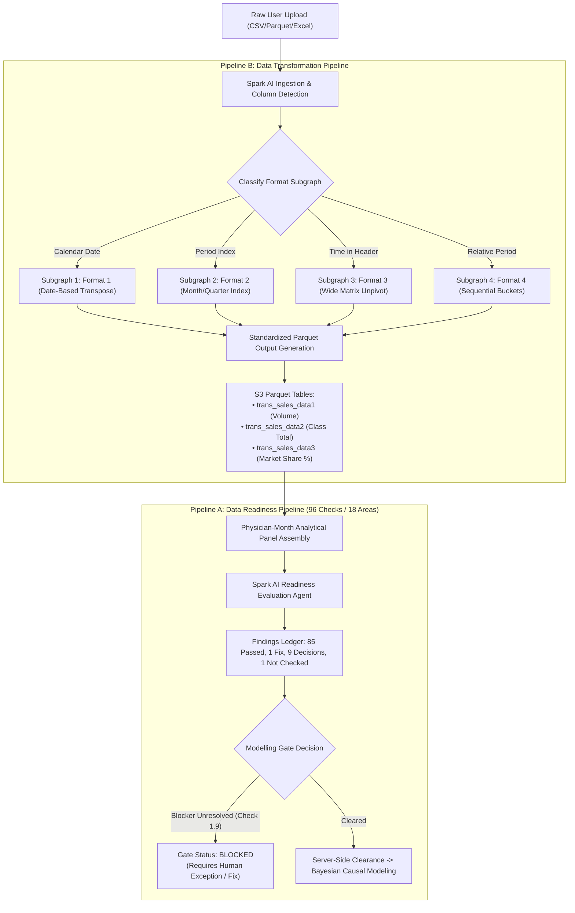

# IngenData: Two-Pipeline Architecture & Spark AI Post-Upload Screen Specification

---

## 1. Executive Summary & Two-Pipeline Architecture

The **IngenData** engine is split into two asynchronous, decoupled pipelines:
1. **Pipeline B — Data Transformation Pipeline**: Detects file layouts, executes one of 4 format-specific subgraphs, and writes standardized Parquet tables (`trans_sales_data1`, `trans_sales_data2`, `trans_sales_data3`).
2. **Pipeline A — Data Readiness Pipeline**: Evaluates the assembled analytical panel against **18 governance areas & 96 checks** to determine if data can safely proceed to Bayesian Causal Modeling (`Cleared` vs `Blocked`).



---

## 2. Post-Upload User Experience Flow

```
[User uploads sales_q1_q4_2024.csv]
       │
       ▼
⚡ "Spark AI is analyzing your dataset..." (Animated Progress Scanner)
   • Step 1/4: Header Sanitization & Ruleset Mapping (Done)
   • Step 2/4: Schema & Format Classification (Done: Format 1 Detected)
   • Step 3/4: Transformation Subgraph Execution (Done: trans_sales_data 1/2/3 created)
   • Step 4/4: Data Readiness & Governance Engine (96 Checks evaluated)
       │
       ▼
📊 DUMMY POST-UPLOAD SCREEN (Visualized Below)
```

---

## 3. Post-Upload Dummy Screen UI (ASCII Mockup)

```
+==============================================================================================================================+
|  INGENDATA | Intelligent Data Ingestion & Governance Studio                                                 Org: Global-Bio  |
+==============================================================================================================================+
|  📁 File: sales_q1_q4_2024.csv  |  Size: 42.8 MB  |  Rows: 1,248,500  |  Columns: 14  |  Status: ⚡ Spark AI Analyzed         |
+------------------------------------------------------------------------------------------------------------------------------+
|                                                                                                                              |
|  🤖 SPARK AI REAL-TIME INGESTION DIAGNOSTIC                                                                                  |
|  --------------------------------------------------------------------------------------------------------------------------  |
|  "I have parsed and classified your uploaded dataset. Column roles were resolved using public.application_specific_ruleset. |
|   The file matches Format 1 (Calendar Date Transactions) and has been transformed into standardized analytical tables.     |
|   However, the Bayesian Causal Modelling Gate is currently BLOCKED pending your review of Check 1.9."                      |
|                                                                                                                              |
+------------------------------------------------------------------------------------------------------------------------------+
|                                                                                                                              |
|  PIPELINE B: TRANSFORMATION REPORT (Format 1 Subgraph)                                                                        |
|  +---------------------------+---------------------------+----------------------------------------------------------------+  |
|  | Detected Column           | Mapped Role               | Status / Confidence                                            |  |
|  +---------------------------+---------------------------+----------------------------------------------------------------+  |
|  | CUSTOMER_ID               | Customer Identifier       | [MATCHED] (via customer_data_ruleset)                          |  |
|  | PRODUCT_CODE              | Product Identifier        | [MATCHED] (via product_data_ruleset)                           |  |
|  | TRANSACTION_DATE          | Transaction Date (Date)   | [MATCHED] (Calendar range: 2024-01-01 to 2024-12-31)           |  |
|  | SALES_QTY                 | Primary Sales Volume      | [MATCHED] (Numeric Float64, non-negative)                      |  |
|  | THERAPEUTIC_CLASS         | Category / Market Class   | [MATCHED] (3 unique classes: Cardio, Oncology, Neuro)          |  |
|  +---------------------------+---------------------------+----------------------------------------------------------------+  |
|                                                                                                                              |
|  GENERATED ANALYTICAL ARTIFACTS (Parquet):                                                                                   |
|  ✔ trans_sales_data1_20241105_qty.parquet  (Customer × Product volume across 52 wks, 12 mos, 4 quarters, annual total)       |
|  ✔ trans_sales_data2_20241105_qty.parquet  (Class-level aggregated customer volumes)                                         |
|  ✔ trans_sales_data3_20241105_qty.parquet  (Product percentage market share within therapeutic class)                       |
|                                                                                                                              |
+------------------------------------------------------------------------------------------------------------------------------+
|                                                                                                                              |
|  PIPELINE A: DATA READINESS & MODELLING GATE (NUROVA Governance Standard)                                                    |
|  +------------------------------------------------------------------------------------------------------------------------+  |
|  |  Gate Status: 🔴 BLOCKED  |  Checks Evaluated: 96 / 96  |  Passed: 85  |  Fix Required: 1  |  Decisions: 9  |  Unchecked: 1  |  |
|  +------------------------------------------------------------------------------------------------------------------------+  |
|                                                                                                                              |
|  ⚠️ ACTION REQUIRED (1 Critical Blocker):                                                                                     |
|  • Check 1.9 [Sources and Assembly]: 14,210 transactions missing physician NPI linkage (orphaned customer IDs).             |
|    Spark AI Recommendation: Drop orphaned rows or apply default National Specialty Clinic provider mapping.                |
|                                                                                                                              |
|  💡 HUMAN DECISIONS RECOMMENDED (Top 3 of 9):                                                                                |
|  • Check 6.3 [Activity Movement]: Promotional digital call activity is stagnant for 18% of prescribers in Q3.              |
|  • Check 10.1 [Channel Collinearity]: High correlation (r = 0.88) between 'Rep F2F Visits' and 'Lunch & Learns'.            |
|  • Check 14.2 [Seasonality]: Detected December prescription drop (-34%) due to holiday deductible reset.                   |
|                                                                                                                              |
+------------------------------------------------------------------------------------------------------------------------------+
|  [ 🛠️ Fix Blocker 1.9 ]   [ 📄 Accept Exception & Log Reason ]   [ 🔄 Re-run Checks ]   [ 🚀 Proceed to Downstream (Disabled) ] |
+==============================================================================================================================+
```

---

## 4. Spark AI Recommendations Card Component (Interactive Details)

When the user clicks on any check in the screen, Spark AI reveals the contextual diagnosis and automated remediation choices:

### Card 1: Critical Blocker Remediation
- **Check ID**: `1.9 - Source Assembly & Identifier Integrity`
- **Impact Area**: `Prescribing Panel Assembly`
- **Spark AI Finding**: 
  > *"Found 14,210 transaction lines ($1.14M volume) with missing or malformed physician IDs that cannot be joined to the master prescriber registry."*
- **Recommended Actions**:
  1. `[Recommended] Apply Automated Filter`: Exclude orphaned transactions from modeling (preserves 98.86% of total revenue).
  2. `Assign to Institutional Bucket`: Remap unlinked records to `HOSPITAL_UNASSIGNED_ACCOUNT`.
  3. `Upload Master Provider Crosswalk`: Upload a secondary NPI lookup table to resolve orphaned identifiers.

### Card 2: Multicollinearity Decision
- **Check ID**: `10.1 - Channels Stepping On Each Other`
- **Impact Area**: `Bayesian Causal Uplift & Media Mix Modeling`
- **Spark AI Finding**: 
  > *"High multicollinearity detected between In-Person Sales Calls and Speaker Programs ($r = 0.88$). If both enter causal modeling simultaneously, parameter coefficients may experience variance inflation."*
- **Recommended Actions**:
  1. `[Recommended] Combine Channels`: Merge into a unified `In-Person High-Touch Promotional Index`.
  2. `Apply Ridge / Hierarchical Priors`: Keep features separated and let Bayesian shrinkage regularize the weights.

---

## 5. API Response Schema (Powers the Screen)

Endpoint: `POST /api/v1/ingendata/pipeline_status`
```json
{
  "status": true,
  "file_details": {
    "file_name": "sales_q1_q4_2024.csv",
    "rows": 1248500,
    "size_mb": 42.8
  },
  "pipeline_b_transformation": {
    "detected_format": "Format 1 (Calendar Date)",
    "ruleset_matches": {
      "customer": "CUSTOMER_ID",
      "product": "PRODUCT_CODE",
      "date": "TRANSACTION_DATE",
      "sales": "SALES_QTY",
      "class": "THERAPEUTIC_CLASS"
    },
    "artifacts_generated": [
      "s3://bucket/trans_sales_data1_20241105_qty.parquet",
      "s3://bucket/trans_sales_data2_20241105_qty.parquet",
      "s3://bucket/trans_sales_data3_20241105_qty.parquet"
    ]
  },
  "pipeline_a_readiness": {
    "gate_status": "BLOCKED",
    "summary": {
      "total_checks": 96,
      "passed": 85,
      "fix_required": 1,
      "human_decisions": 9,
      "not_checked": 1
    },
    "blocker": {
      "check_id": "1.9",
      "area": "Sources and Assembly",
      "message": "14,210 transactions missing physician NPI linkage.",
      "ai_recommendation": "Drop orphaned rows or assign to default clinic bucket."
    }
  }
}
```
