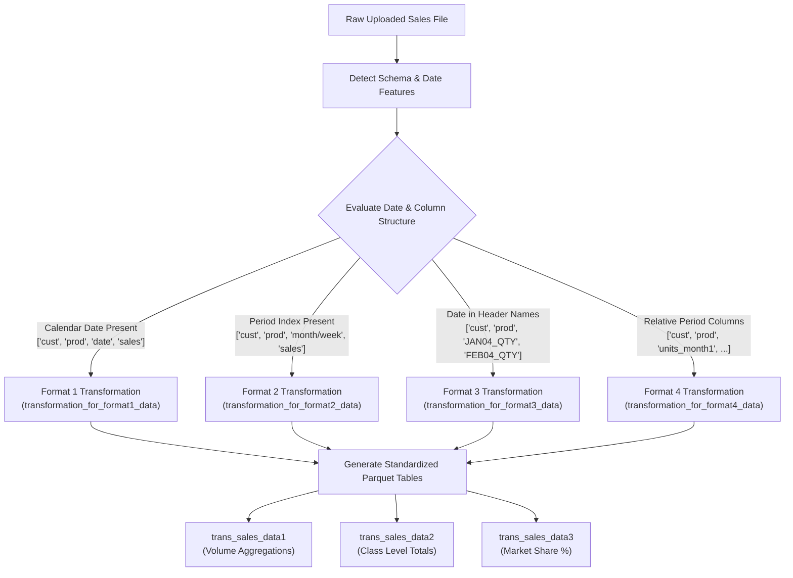

# IngenData: Transformation Rules & Pipeline Architecture Reference

## 1. Overview & Architectural Role
**IngenData** serves as the foundational data ingestion, schema normalization, and feature transformation layer within the platform. When raw sales or commercial audit datasets are uploaded, IngenData executes:
1. **Automated Header Detection** against metadata dictionary rulesets.
2. **Data Format Classification** into one of 4 canonical sales schemas.
3. **Temporal Aggregation & Pivoting** to create standardized volume and share tables (`trans_sales_data1`, `trans_sales_data2`, `trans_sales_data3`).

---

## 2. Code Anchors & File Paths

| Component / Sub-System | Exact File Path | Line Range | Key Function / Class |
| :--- | :--- | :--- | :--- |
| **API Entry Point** | [`python_code.py`](file:///home/srivatsav/Downloads/ingenspark-pythoncode-File-Upload-APIs-Revamp%20(1)/ingenspark-pythoncode-File-Upload-APIs-Revamp/python_code.py) | [Lines 3179–3245](file:///home/srivatsav/Downloads/ingenspark-pythoncode-File-Upload-APIs-Revamp%20(1)/ingenspark-pythoncode-File-Upload-APIs-Revamp/python_code.py#L3179-L3245) | `POST /salestransformation` |
| **Ruleset Column Detection & Save** | [`python_code.py`](file:///home/srivatsav/Downloads/ingenspark-pythoncode-File-Upload-APIs-Revamp%20(1)/ingenspark-pythoncode-File-Upload-APIs-Revamp/python_code.py) | [Lines 6365–6605](file:///home/srivatsav/Downloads/ingenspark-pythoncode-File-Upload-APIs-Revamp%20(1)/ingenspark-pythoncode-File-Upload-APIs-Revamp/python_code.py#L6365-L6605) | `POST /insert_sales_data_columns_name` |
| **Transformation Controller** | [`ingencustomer_views.py`](file:///home/srivatsav/Downloads/ingenspark-pythoncode-File-Upload-APIs-Revamp%20(1)/ingenspark-pythoncode-File-Upload-APIs-Revamp/ingencustomer_views.py) | [Lines 2790–3035](file:///home/srivatsav/Downloads/ingenspark-pythoncode-File-Upload-APIs-Revamp%20(1)/ingenspark-pythoncode-File-Upload-APIs-Revamp/ingencustomer_views.py#L2790-L3035) | `salestransformation_view` |
| **Core Transformation Class** | [`ingencustomer_views.py`](file:///home/srivatsav/Downloads/ingenspark-pythoncode-File-Upload-APIs-Revamp%20(1)/ingenspark-pythoncode-File-Upload-APIs-Revamp/ingencustomer_views.py) | [Lines 1121–2788](file:///home/srivatsav/Downloads/ingenspark-pythoncode-File-Upload-APIs-Revamp%20(1)/ingenspark-pythoncode-File-Upload-APIs-Revamp/ingencustomer_views.py#L1121-L2788) | `class SalesDataTansformation` |
| **Format 1 Transformer** | [`ingencustomer_views.py`](file:///home/srivatsav/Downloads/ingenspark-pythoncode-File-Upload-APIs-Revamp%20(1)/ingenspark-pythoncode-File-Upload-APIs-Revamp/ingencustomer_views.py) | [Lines 766–850, 1909–2070](file:///home/srivatsav/Downloads/ingenspark-pythoncode-File-Upload-APIs-Revamp%20(1)/ingenspark-pythoncode-File-Upload-APIs-Revamp/ingencustomer_views.py#L766-L850) | `transform_sales_volume_for_format1` |
| **Format 2 Transformer** | [`ingencustomer_views.py`](file:///home/srivatsav/Downloads/ingenspark-pythoncode-File-Upload-APIs-Revamp%20(1)/ingenspark-pythoncode-File-Upload-APIs-Revamp/ingencustomer_views.py) | [Lines 929–1020, 2071–2300](file:///home/srivatsav/Downloads/ingenspark-pythoncode-File-Upload-APIs-Revamp%20(1)/ingenspark-pythoncode-File-Upload-APIs-Revamp/ingencustomer_views.py#L929-L1020) | `transform_sales_volume_for_format2` |
| **Format 3 Transformer** | [`ingencustomer_views.py`](file:///home/srivatsav/Downloads/ingenspark-pythoncode-File-Upload-APIs-Revamp%20(1)/ingenspark-pythoncode-File-Upload-APIs-Revamp/ingencustomer_views.py) | [Lines 2301–2450, 2562–2643](file:///home/srivatsav/Downloads/ingenspark-pythoncode-File-Upload-APIs-Revamp%20(1)/ingenspark-pythoncode-File-Upload-APIs-Revamp/ingencustomer_views.py#L2301-L2450) | `transformation_for_format3_data` |
| **Format 4 Transformer** | [`ingencustomer_views.py`](file:///home/srivatsav/Downloads/ingenspark-pythoncode-File-Upload-APIs-Revamp%20(1)/ingenspark-pythoncode-File-Upload-APIs-Revamp/ingencustomer_views.py) | [Lines 2644–2788](file:///home/srivatsav/Downloads/ingenspark-pythoncode-File-Upload-APIs-Revamp%20(1)/ingenspark-pythoncode-File-Upload-APIs-Revamp/ingencustomer_views.py#L2644-L2788) | `transformation_for_format4_data` |
| **Column Ruleset Detection Utility** | [`functions.py`](file:///home/srivatsav/Downloads/ingenspark-pythoncode-File-Upload-APIs-Revamp%20(1)/ingenspark-pythoncode-File-Upload-APIs-Revamp/functions.py) | [Lines 377–445](file:///home/srivatsav/Downloads/ingenspark-pythoncode-File-Upload-APIs-Revamp%20(1)/ingenspark-pythoncode-File-Upload-APIs-Revamp/functions.py#L377-L445) | `sales_trans_column_detection` |

---

## 3. Automated Column Detection Rulesets

When an input table is processed, column headers are sanitized (spaces and underscores removed, converted to lowercase) and classified against database dictionary tables:

### 3.1 `public.application_specific_data_ruleset`
Maps raw column headers to functional analytical categories:
- **Customer Identifier**: Matches `customer_id_var` and `customer_name_var` (e.g., `customerid`, `account_no`, `doctor_id`, `npi`).
- **Product Identifier**: Matches `product_id_var` and `product_name_var` (e.g., `productcode`, `brand`, `item_type`, `drug_name`).
- **Sales Metrics**: Matches `sales_var1`, `sales_var2`, `sales_var3` (e.g., `quantity`, `units`, `sales`, `revenue`, `trx`, `nrx`).
- **Temporal Variables**: Matches `date`, `week_var`, `month_var`, `quarter_var` (e.g., `order_date`, `week_number`, `cal_month`).

### 3.2 Domain-Specific Dictionary Rulesets
- **`public.customer_data_ruleset`**: Recognizes demographic, specialty, and geographic columns (`customer_type`, `address_line1`, `zip_code`, `first_name`).
- **`public.product_data_ruleset`**: Recognizes category, group, and therapeutic classes (`class`, `therapeutic_area`, `category`).

---

## 4. The 4 Sales Transformation Format Rules

---

### Rule 1: Data Format 1 (Sales on Specific Calendar Date)
- **Input Structure**: Narrow/long transaction log:
  $$\text{Columns} = [\text{customer\_id}, \text{product\_id}, \text{date}, \text{sales\_metric}]$$
- **Processing Logic**:
  1. Decomposes `date` into ISO week numbers ($1 \dots 52$), calendar months ($1 \dots 12$), calendar quarters ($1 \dots 4$), and years.
  2. Aggregates metrics at the `(customer, product)` level.
  3. Dynamic column naming:
     - Weekly: `<Year>_<SalesMetric>_wk<1..52>`
     - Monthly: `<Year>_<SalesMetric>_month<1..12>`
     - Quarterly: `<Year>_<SalesMetric>_quarter<1..4>`
     - Annual Total: `<Year>_Total_<SalesMetric>`
  4. Market Share Derivation:
     $$\text{Share}_{c, p, t} = \left( \frac{\text{Sales}_{c, p, t}}{\sum_{q \in \text{Class}} \text{Sales}_{c, q, t}} \right) \times 100$$
     Yields column: `<Product>_<Class>_<Year>_Total_<SalesMetric> share percent`.

---

### Rule 2: Data Format 2 (Period Number / Categorical Time)
- **Input Structure**: Records where time is specified by index or name:
  $$\text{Columns} = [\text{customer\_id}, \text{product\_id}, \text{Month / Week / Quarter}, \text{sales\_metric}]$$
- **Processing Logic**:
  1. Parses textual month names (e.g. `'Jan'`, `'February'`) to 2-digit numeric codes `01..12`.
  2. Groups by `(customer, product, period)` and pivots into chronological period metrics.
  3. Materializes `trans_sales_data1` and `trans_sales_data3`.

---

### Rule 3: Data Format 3 (Time-Period and Sales Metric in Headers)
- **Input Structure**: Wide pre-aggregated matrices:
  $$\text{Columns} = [\text{customer\_id}, \text{product\_id}, \text{JAN04\_QTY}, \text{FEB04\_QTY}, \dots, \text{DEC04\_QTY}, \text{JAN04\_NRX}, \dots]$$
- **Processing Logic**:
  1. Regular expression tokenization detects date/year fragments inside header strings.
  2. Drops columns where all values are null or zero.
  3. Reconstructs monthly series and annual totals (`<Year>_Total_<Metric>`).
  4. Calculates customer $\times$ product shares within category for each detected timeframe.

---

### Rule 4: Data Format 4 (Relative Unspecified Period Columns)
- **Input Structure**: Files without calendar timestamps, containing relative period counters:
  $$\text{Columns} = [\text{customer\_id}, \text{product\_id}, \text{units\_month1}, \text{units\_month2}, \dots, \text{units\_month12}]$$
- **Processing Logic**:
  1. Separates physical volume (`'units'`, `'qty'`) from monetary metrics (`'dollar'`, `'revenue'`).
  2. Groups by `(customer, product)` and computes cumulative annual and period totals.
  3. Evaluates relative brand shares across the sequential periods.

---

## 5. Output Standardized Parquet Tables

| Output Table Identifier | Granularity | Data Contained | Downstream Consumer Modules |
| :--- | :--- | :--- | :--- |
| **`trans_sales_data1`** | `(Customer, Product)` | Volume aggregations by week, month, quarter, and year | **Decile**, **Quartile**, **Volume Trend** |
| **`trans_sales_data2`** | `(Customer, Class)` | Total category/class-level volumes | **Customer 360** |
| **`trans_sales_data3`** | `(Customer, Product, Class)` | Percentage market shares within therapeutic class | **Market Dominant**, **Share Trend** |

All generated parquet files are saved to Amazon S3 under:
`S3_Transformation_Tables_Folder + "trans_sales_data{1|2|3}_" + <timestamp> + "_" + <sales_metric>`
and cataloged in `public.user_file_upload.transformed_tablenames`.
